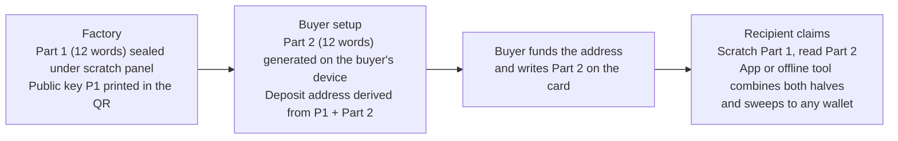

# Bitcard

**A physical bitcoin gift card that nobody, including Bitcard, can spend alone.**

[](https://github.com/deFox22/bitcard/actions/workflows/live-hash-monitor.yml)
[](LICENSE)

Bitcard is an open standard and a set of self-contained tools for a card that carries a bitcoin key split into two halves of 12 words. One half is sealed under a scratch panel at the factory. The other half is generated on the buyer's own device and written on the card by hand. Only the person holding the physical card with both halves can move the bitcoin. Bitcard never holds a complete key and never touches funds.

Everything needed to recover the bitcoin is on the card and in this repository. If the company, the website and the app all disappeared, the two word-halves plus the open specification would still reconstruct the key.

Live site: https://bitcardswallet.com. Hosted app: https://bitcardssetup.com/app.html. Offline tool: https://bitcardssetup.com/offline.html.

## How it works



The two halves are ordinary BIP39 phrases. Each becomes a secp256k1 scalar; the spending key is their sum modulo the curve order, and the funding address is the standard native SegWit (P2WPKH) address of the combined public key. There is no on-chain multisig and no Bitcard server in the money path. The full mechanism, with a worked example from the published test vectors, is in [docs/HOW-IT-WORKS.md](docs/HOW-IT-WORKS.md).

## Start here

| If you are | Read |
|---|---|
| Holding a card and want your bitcoin | [recover/recover.html](recover/recover.html) (plain-English instructions, works offline), then either the hosted app, the offline tool or `recover/bitcard-recover.py`. Summary in [Recover without Bitcard](#recover-funds-without-any-bitcard-service) below. |
| A developer or reviewer checking the code | [docs/HOW-IT-WORKS.md](docs/HOW-IT-WORKS.md), then [spec/bitcard-claim-spec.md](spec/bitcard-claim-spec.md), then [Rebuild it yourself](#rebuild-it-yourself). The test gate is `node test-all.mjs` in `build/`. |
| A security researcher | [SECURITY.md](SECURITY.md): threat model, what is and is not protected, how to report. |
| Operating a print run or a release | [MINT-RUNBOOK.md](MINT-RUNBOOK.md) for manufacturing and [docs/RELEASE.md](docs/RELEASE.md) for publishing the app. |
| Press or a partner | The media kit at https://bitcardswallet.com/media-kit.html and the trust model section below. |

## What is in this repository

| Path | What it is |
|---|---|
| `app/claim-app.html` | The complete claim app in one self-contained HTML file. No external scripts, no server, no accounts. Scan the card, enter the words, sweep. |
| `app/offline.html` | The offline tool. No network code at all (CSP `connect-src 'none'`). Sets up a card (generates Part 2, derives the deposit address on-device) and opens a card (reconstructs the key as a WIF to sweep with any wallet). |
| `recover/recover.html` | Plain-English recovery instructions for a holder. Works from a saved copy. |
| `recover/bitcard-recover.py` | Recovery tool in pure Python standard library, Python 3.7 or newer. Run `python bitcard-recover.py --selftest` on the interpreter you intend to use. |
| `spec/bitcard-claim-spec.md` | The normative open standard: key scheme, card record format, flows, sweep rules, recovery. |
| `spec/bitcard-test-vectors.json` | Frozen derivation vectors. A correct implementation reproduces them byte for byte. |
| `spec/bitcard-signed-transaction-vector.json` | A frozen signed sweep transaction accepted by an independent Bitcoin Core regtest node, with prevout, script, amount, txid and BIP143 digest. |
| `spec/bitcard-claim-history.md` | Non-normative design history, kept separate so retired text is never mistaken for a requirement. |
| `print/qc-tool.html` | Keyless, offline manufacturing QC tool. Confirms that the words sealed on each physical card match that card's QR, and exports the public audit record. |
| `MINT-RUNBOOK.md` | The required production sequence: serial reservation, minting, printer handoff, physical QC, reconciliation, destruction of maker copies. |
| `build/` | All source, the pinned dependency lockfile, vendored fonts, the CLI mint, the serial ledger and 21 test suites. Browser minting is deliberately disabled. |
| `monitor/` | Hourly integrity monitor that compares the live site to the published hashes, plus a watchdog. |
| `docs/` | Explanations and procedures that are not part of the normative spec. |

## The trust model in one paragraph

Cards carry no issuer key and the app verifies no issuer signature. This is an open, permissionless format, like BIP39: anyone may make a compatible card or tool. A card QR is just `base64url` of a public record: 41 bytes for record v1 (the 2026 pilot cards) or 46 bytes for record v2 (all later cards), which appends a 5-byte SHA-256 checksum so a mistyped card code is rejected instead of silently sending funds to a key nobody holds. Claim and recovery accept both formats. Because v1 cannot check itself, the official apps allow funding of a v1 card only when it exactly matches the table of records Bitcard actually issued; unknown v1 records can still be claimed and recovered.

## What you must trust, and what you do not

- **To recover funds, no Bitcard service is required.** The two word-halves plus the open method (or the included tool) reconstruct the key offline. You still trust, or independently verify, the recovery implementation, your device and your destination wallet.
- **To claim through the hosted app you trust that you loaded the genuine page.** Like any web wallet, a compromised host could serve altered code. The published hash below and the in-app code fingerprint let you check the program, and the hourly monitor watches the live bytes, but the real protection is loading it from a source you trust.
- **To avoid trusting a website at all, use the offline tool.** It contains no network code, reconstructs the key on your device and hands it to a standard wallet's Sweep. The hosted copy refuses word entry until you download it: save the file, verify its SHA-256, disconnect, then open it.

This is an additive two-part key, not an on-chain multisig. It gives two-party control before claim and ordinary fees. It does not provide multisig features such as independent signing, timelocks or revocation.

## Verify the released app

```
sha256 of app/claim-app.html:
0c338cd34ba73994282414607cc471b78de8fe3d4b04e1e6a720a7cd082e11c2
sha256 of app/offline.html:
728b6ec5c5a358c63c549ae9c963d89a72dc1f09fc7dd9c645a8edb1b009ffd7
```

PowerShell: `Get-FileHash app/claim-app.html`. Linux and macOS: `shasum -a 256 app/claim-app.html`.

The same files are deployed at https://bitcardssetup.com/app.html and https://bitcardssetup.com/offline.html and must hash identically. The app also displays a runtime fingerprint of its own inline script (open "Is this app genuine?" at the bottom of the page). The GitHub workflow in `.github/workflows/live-hash-monitor.yml` re-checks the live site every hour against `monitor/expected-hashes.json`.

## Rebuild it yourself

The build reads only files committed in this repository. A fresh clone reproduces the released files byte for byte.

```
cd build
npm ci                    # on Windows PowerShell use npm.cmd / npx.cmd
npx esbuild app-claim.js --bundle --format=iife --minify --charset=ascii --target=es2020 --outfile=app-claim.bundle.js
node assemble.mjs template-claim.html app-claim.bundle.js ../app/claim-app.html
npx esbuild app-offline.js --bundle --format=iife --minify --charset=ascii --target=es2020 --outfile=app-offline.bundle.js
node assemble.mjs template-offline.html app-offline.bundle.js ../app/offline.html
npx esbuild app-qc.js --bundle --format=iife --minify --charset=ascii --target=es2020 --outfile=app-qc.bundle.js
node assemble.mjs template-qc.html app-qc.bundle.js ../print/qc-tool.html
node test-all.mjs         # must print ALL SUITES PASSED
```

The gate runs 21 suites, including a byte-for-byte reproduction check, derivation against the frozen vectors, the frozen signed transaction, the claim and offline user-interface flows, hostile-network and timeout behaviour, entropy guards, record checksums, mint guards and spec-to-code consistency.

## Recover funds without any Bitcard service

You need both sets of 12 words from the card. Run `recover/bitcard-recover.py` or open the offline tool; either reconstructs the key on your device with no network. Or re-implement from the spec: each half is a BIP39 phrase (English wordlist, empty passphrase) turned into a BIP32 master private key that is used directly as a scalar; the spending key is `(d1 + d2) mod n` on secp256k1; the address is P2WPKH of the combined public key. The result is a standard WIF. Sweep it with a wallet such as Sparrow or Electrum using the native SegWit (P2WPKH) source type. Sweep, do not Import, and confirm the wallet's source address equals the card's funding address before sending.

**Copy this repository freely.** Redundant, periodically verified copies are what make the recovery design resilient to a website or company disappearing.

## Project status

- Specification: v0.4, marked DRAFT while the format is exercised in production. The on-wire formats in sections 4.1 and 4.3 are frozen.
- Deployed release: the hashes above, stamped by `build/release-finish.mjs` and watched hourly.
- Serial ranges recorded in `build/serial-allocations.json`: 101 to 400 (record v1 pilot), 1000 to 1299 (record v2), 2000 to 2299 (record v2 retail) and 3000 to 3299 (record v2 retail). Serials are inventory data, not authentication.
- Independent reviews: an external audit of the testnet build in June 2026 and external security reviews in August and September 2026. Findings and their fixes are recorded in the commit history and in `spec/bitcard-claim-history.md`.

## Release and manufacturing

Publishing the app follows [docs/RELEASE.md](docs/RELEASE.md). Producing cards follows [MINT-RUNBOOK.md](MINT-RUNBOOK.md). Passing the software gate never replaces the physical controls in the runbook, and a batch is not released until a named person signs off on the complete record.

## Security

See [SECURITY.md](SECURITY.md) for the threat model, the honest limits and how to report a vulnerability.

## License

MIT. See [LICENSE](LICENSE).
