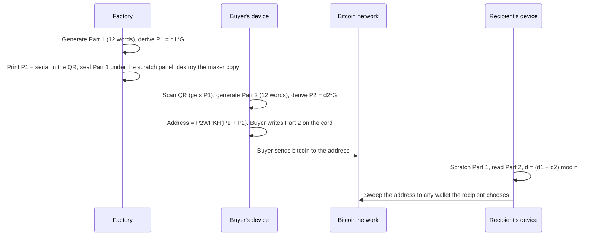

# How a Bitcard works

This is the explanatory companion to the normative specification in [`spec/bitcard-claim-spec.md`](../spec/bitcard-claim-spec.md). Where the two disagree, the specification wins. Every value below comes from the published vectors in [`spec/bitcard-test-vectors.json`](../spec/bitcard-test-vectors.json) and can be recomputed with `recover/bitcard-recover.py`.

## The idea in one sentence

A Bitcard is an ordinary single-key bitcoin address whose private key is the sum of two secret numbers, each written down as 12 words, held by two different parties until the card is claimed.

## The four moments in a card's life



1. **Manufacture.** The factory generates Part 1, derives its public key P1 and prints P1 (never the words) into the card's QR. The words are sealed under a scratch panel. After a read-back check confirms the sealed words match the printed P1, the maker's copy is destroyed under witness. From this point Bitcard holds no secret.
2. **Setup.** The buyer scans the QR with the app or the offline tool. Their device generates Part 2 and combines its public key with P1 to produce the funding address. Part 2 never leaves the device except by the buyer's own hand, written on the card. Nothing about Part 2 is sent anywhere.
3. **Funding.** The buyer sends bitcoin to the address from any wallet or exchange. The app can show the balance because the address is public; it cannot spend because it never had both halves.
4. **Claim.** The recipient scratches off Part 1, reads Part 2 from the card, and enters both. The app derives the key, builds a sweep transaction to the recipient's own wallet, checks it, and broadcasts it. Alternatively the offline tool or the Python script prints a standard private key (WIF) that any wallet can sweep.

## The mathematics

Each half is a standard BIP39 phrase (English wordlist, empty passphrase). It is turned into a number the same way every wallet does:

1. BIP39: `PBKDF2-HMAC-SHA512(mnemonic, "mnemonic", 2048 iterations)` gives a 64-byte seed.
2. BIP32: `HMAC-SHA512(key = "Bitcoin seed", data = seed)`; the left 32 bytes are the master private key.
3. Bitcard uses that master private key directly as a scalar on secp256k1. This is the one non-standard step: a normal wallet would derive child keys from it, which is why neither phrase on its own opens anything in an ordinary wallet, even though each is a valid BIP39 phrase.

With `d1` from Part 1 and `d2` from Part 2 and `G` the curve generator:

```
P1 = d1 * G                       printed in the QR
P2 = d2 * G                       computed on the buyer's device
P  = P1 + P2 = (d1 + d2) * G       the combined public key (point addition)
d  = (d1 + d2) mod n               the spending key, known only when both halves are present
address = P2WPKH(compressed P)     a normal bc1q address
```

Because point addition is commutative, swapping the halves gives the same address (vector 2 in the vectors file is exactly that check). Because the sum is reduced modulo the curve order `n`, an implementation that forgets `mod n` gives the wrong key in roughly half of all cases; vector 3 is constructed so `d1 + d2 >= n` and exposes that bug.

Validation rules that every implementation must apply: reject a half whose scalar is 0 or at least `n`; reject a P1 that is not a valid compressed point; reject a combined key of 0; enforce the BIP39 checksum on every phrase. The probability of hitting any of these with honest random words is below 1 in 10^38.

## A worked example (vector 1)

| Quantity | Value |
|---|---|
| Part 1 words | `abandon abandon abandon abandon abandon abandon abandon abandon abandon abandon abandon about` |
| d1 | `1837c1be8e2995ec11cda2b066151be2cfb48adf9e47b151d46adab3a21cdf67` |
| P1 (in the QR) | `03d902f35f560e0470c63313c7369168d9d7df2d49bf295fd9fb7cb109ccee0494` |
| Part 2 words | `legal winner thank year wave sausage worth useful legal winner thank yellow` |
| d2 | `7e56ecf5943d79e1f5f87e11c768253d7f3fcf30ae71335611e366c578b4564e` |
| d = (d1 + d2) mod n | `968eaeb422670fce07c620c22d7d41204ef45a104cb8e4a7e64e41791ad135b5` |
| Combined public key | `0224e2c50bd374f89dd83f7be42af1ef0a3d3092314ec76cdcbd10eea5c425a51c` |
| Mainnet address | `bc1q6h6zqgr7pzgf4e2j86f2v4m60r5p0wqrvtkvyg` |
| WIF (what the recovery tool prints) | `L2GNgkXGSNjb1fTyt9WSbwHX8s3LwRRYNExo8AoBAg2yTDJMnXBF` |

These are published BIP39 test phrases, so this key is public and holds nothing. Real cards use freshly generated words.

Run it yourself:

```
python recover/bitcard-recover.py --part1 "abandon abandon abandon abandon abandon abandon abandon abandon abandon abandon abandon about" --part2 "legal winner thank year wave sausage worth useful legal winner thank yellow"
```

## What is printed in the QR

The QR encodes `https://bitcards.xyz/app.html#<base64url of the record>`. The fragment after `#` is never sent to a server, so opening the link tells the host nothing about which card was scanned. The record itself:

| Offset | Bytes | Field | Value |
|---|---|---|---|
| 0 | 1 | version | `0x01` (record v1) or `0x02` (record v2) |
| 1 | 1 | network | `0x00` mainnet, `0x01` testnet, `0x02` signet |
| 2 | 1 | script type | `0x01` = P2WPKH |
| 3 | 1 | key derivation id | `0x01` = the BIP39 / BIP32-master method above |
| 4 | 33 | P1 | compressed public key of Part 1 |
| 37 | 4 | serial | unsigned 32-bit, big-endian |
| 41 | 5 | checksum | record v2 only: first 5 bytes of `SHA-256` over the preceding 41 bytes |

A v2 record from the vectors: `0200010103d902f35f560e0470c63313c7369168d9d7df2d49bf295fd9fb7cb109ccee0494ffffff5335fccd3f8c`. The last five bytes, `35fccd3f8c`, are the checksum. Flip any character of the code and the checksum fails before the app reads anything else.

Why the checksum matters: with the original 41-byte record, about 39 percent of single-character typing mistakes in a card code still decode to a structurally valid record carrying a different valid public key. A buyer who funded such an address would be sending bitcoin to a key nobody holds. Record v2 closes that; for the v1 pilot cards, the official apps allow funding only when the record exactly matches the table of records Bitcard actually issued.

The record contains no signature and no secret. Anyone may make a compatible card. A serial is inventory data and proves nothing about authenticity.

## What the claim app checks before it spends

- **Two independent public nodes must agree** on exactly which coins sit at the address, including amounts and confirmation state. Any disagreement, missing node or hang (15 second deadline, 1 MiB response cap) stops the claim.
- **The Part 1 words must reproduce the P1 in the QR.** A mistyped or wrong Part 1 is rejected before any key is combined.
- **The destination is shown and confirmed**, then compared again at the moment of sending. An edit in between cancels the signed transaction.
- **The signed transaction is inspected**: one input per coin, one output to the reviewed destination, fee within a capped and sanity-bounded range, replace-by-fee enabled, witness key matching the card's address.
- **Coins are re-checked immediately before broadcast**, and the node must echo the exact transaction id the app computed.
- **After broadcast**, the app reports whether more than one node has accepted and seen the transaction, and offers a fee bump if it is slow.

The frozen transaction in [`spec/bitcard-signed-transaction-vector.json`](../spec/bitcard-signed-transaction-vector.json) is a real sweep of the vector-1 card key, accepted by an independent Bitcoin Core node on regtest: one P2WPKH input, one output, 110 virtual bytes, fee 220 satoshi. Its BIP143 digest and signature are published so that any implementer can verify their signing code against it.

## Recovering without Bitcard

Everything above is deterministic and uses only standard primitives: BIP39, PBKDF2-HMAC-SHA512, HMAC-SHA512, secp256k1, SHA-256, RIPEMD-160, bech32 and WIF. `recover/bitcard-recover.py` implements all of it in about 340 lines of Python standard library, with the wordlist and curve constants embedded and a `--selftest` that reproduces the vectors. Any competent developer can reimplement it from the specification in an afternoon. That, and not any Bitcard server, is what makes the bitcoin on a card permanently recoverable.
